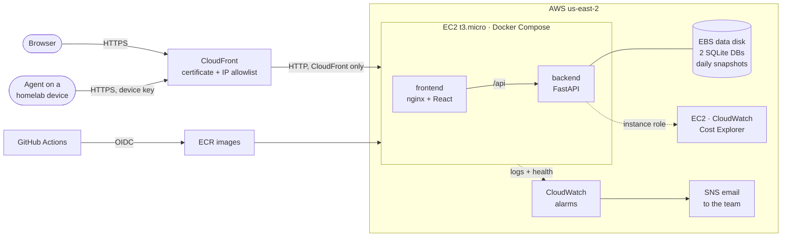

# CloudOps Hub

CloudOps Hub is a cloud-native infrastructure monitoring and
operations platform designed for homelab enthusiasts, power users,
and small businesses.

The platform provides centralized infrastructure visibility,
monitoring, alerting, asset management, and operational insights
through a unified interface.

## Project Status

🛠️ Proof of Concept / Development Phase

CloudOps Hub is currently being developed as a capstone project
for the Cloud Architecture and Administration program at Seneca.

👉 See [`docs/PROGRESS.md`](docs/PROGRESS.md) for what has been done,
what is in progress, and what is next.

👉 See [`CONTRIBUTING.md`](CONTRIBUTING.md) for how to set up the
project and how we use branches and pull requests.

## Repository Structure

```
CloudOpsHub/
├── frontend/          React + TypeScript dashboard (Vite)
├── backend/           REST API (Python / FastAPI)
├── infra/             Docker, docker-compose, Terraform (AWS), deploy script
├── .github/workflows/ CI pipelines (GitHub Actions)
└── docs/
    ├── api/           API contract shared by frontend and backend
    ├── architecture/  Design documents
    ├── planning/      Risk register, SWOT, mind map, workflow
    └── PROGRESS.md    Running log of team progress
```

Each top-level folder has its own `README.md` explaining how to run it.

## Quick Start

```bash
# Frontend (http://localhost:5173)
cd frontend
npm install
npm run dev
```

```bash
# Backend (http://localhost:8000/docs)
cd backend
python -m venv .venv
.venv\Scripts\activate         # macOS/Linux: source .venv/bin/activate
pip install -r requirements-dev.txt
fastapi dev app/main.py
```

```bash
# Everything in Docker (frontend http://localhost:8080)
cd infra
docker compose up --build
```

More detail in each folder's `README.md` and in [`CONTRIBUTING.md`](CONTRIBUTING.md).

## Live Deployment

**https://drk4col17f8z3.cloudfront.net** · AWS, us-east-2 · deployed with Terraform

The dev site is **limited to approved IP addresses** (the demo logins in `backend/seed.py` are public),
so ask the team to add yours. Everything else is automatic:

| | How |
| --- | --- |
| **Deploy** | Merge a PR into `main` → GitHub Actions builds the images, pushes them to ECR and deploys within minutes. If the new version isn't healthy, the server **rolls back on its own** |
| **HTTPS** | CloudFront with an AWS certificate; `http://` redirects to `https://` |
| **Data** | Both databases live on a separate encrypted disk that survives server rebuilds, with **daily snapshots** kept 7 days |
| **Monitoring** | Container logs in CloudWatch; the team is **emailed within ~4 minutes** if the site goes down or throws errors, and again when it recovers |
| **Security** | No AWS keys anywhere (server uses an IAM role, GitHub uses OIDC); the server accepts traffic only from CloudFront; no SSH (SSM Session Manager) |
| **Cost** | One t3.micro; budget alarm emails the team at $5 and $10 per month |

How to run, change or rebuild it: [`infra/terraform/README.md`](infra/terraform/README.md).

## Objectives

- Centralize infrastructure monitoring
- Provide asset and service visibility
- Generate configurable operational alerts
- Implement secure cloud architecture
- Automate infrastructure deployment
- Implement CI/CD practices
- Design for scalability and resiliency
- Apply cloud well-architected principles

## Planned Capabilities

### Monitoring

- CPU utilization
- Memory utilization
- Disk utilization
- Uptime
- Service health

### Asset Management

- Servers
- Virtual machines
- Containers
- NAS devices
- Services

### Alerting

- Device offline
- Resource threshold exceeded
- Storage capacity warnings
- Service failures

## Target Users

CloudOps Hub is designed around a tiered model:

### Homelab

Infrastructure monitoring for self-hosted environments.

### Pro

Advanced monitoring, historical reporting, backup visibility,
and security insights.

### Business

Team access, RBAC, governance, cloud integrations, and advanced
operational visibility.

## Architecture



More detail:

- [`docs/architecture/CloudOps_Hub_Architecture_Guide.pdf`](docs/architecture/CloudOps_Hub_Architecture_Guide.pdf): how the whole system works
- [`infra/terraform/README.md`](infra/terraform/README.md): the AWS deployment, decisions and runbooks
- [`docs/requirements/REQUIREMENTS.md`](docs/requirements/REQUIREMENTS.md): what the system must do
- [`docs/api/frontend-contract.md`](docs/api/frontend-contract.md): the API

## Project Documentation

Project planning documentation can be found in:

`docs/planning/`

## Technology Stack

| Layer          | Technology                                   |
| -------------- | -------------------------------------------- |
| Frontend       | React 19, TypeScript, Vite, Recharts, Axios  |
| Backend        | Python, FastAPI                              |
| Containers     | Docker, docker-compose                       |
| CI/CD          | GitHub Actions                               |
| Infrastructure | Terraform (planned), cloud provider TBD      |

## AWS Integration

The dashboard shows the connected AWS account: identity, EC2 instances with their CloudWatch CPU,
and this month's cost with a forecast (cached 6 h, since Cost Explorer charges per call).

- **Deployed:** the backend uses the server's **IAM role** (read-only, 5 actions); no access keys
- **Locally:** a read-only IAM user's named profile (`AWS_PROFILE`); see
  [`docs/architecture/aws-integration.md`](docs/architecture/aws-integration.md) for setup, the exact policy,
  and the one-Region limit of AWS Settings accounts

All endpoints require login. Response shapes: `docs/api/frontend-contract.md`.

```http
GET /api/aws/account
GET /api/aws/ec2
GET /api/aws/ec2/{instanceId}/cpu?hours=3
GET /api/billing/summary
```


## Roadmap

- [x] Project concept
- [x] Scope statement
- [x] Project charter
- [x] Risk register
- [x] SWOT analysis
- [x] Initial AWS IAM integration
- [x] Live AWS account endpoint
- [x] EC2 inventory and CloudWatch CPU endpoints
- [x] Authentication and role-based access (JWT, admin / operator / viewer)
- [x] CI on pull requests (frontend lint and build, backend tests)
- [ ] Requirements specification
- [ ] Architecture design
- [ ] Proof of concept
- [ ] Infrastructure as Code
- [ ] CD (automated deployment)
- [ ] MVP deployment
- [ ] Monitoring and observability
- [ ] Security validation
- [ ] Disaster recovery testing

## Disclaimer

This project is currently under active development as an
academic capstone and independent portfolio project.
